# Arbor 演示环境与功能导览

本目录提供一套**可直接复现**的 Arbor 演示数据：电商订单业务库、8 条流程、8 个应用、1 个应用广场、定时任务、脚本/接口/Redis 配置、演示账号与截图。

目标：克隆代码后，按本文档导入种子数据并启动服务，即可在页面上把 Arbor 的主要功能走一遍。

---

## 1. 演示环境一览

| 组件 | 地址 / 配置 | 说明 |
|---|---|---|
| Arbor 后端 | `http://localhost:8088` | Spring Boot |
| Arbor 前端 | `http://localhost:5173`（开发模式）或 `http://localhost:8088`（构建后） | Vue 3 + NaiveUI |
| 平台数据库 | `127.0.0.1:3306/arbor1` | 平台表 + 演示业务表 |
| 演示业务库（prod 覆写） | `127.0.0.1:3306/arbor_demo` | 用于演示“数据源按环境覆写” |
| 平台 Redis | `127.0.0.1:6379/0` | Token、平台缓存 |
| 演示 Redis | `127.0.0.1:6379/1` | Redis 节点/配置使用，和平台缓存隔离 |
| Mock API | `http://127.0.0.1:8090` | 零依赖 Node 服务，供接口节点联调 |

> 上面的端口和本机账号是演示默认值。换成你自己的 MySQL/Redis 时，只需改环境变量和页面里的数据源配置。

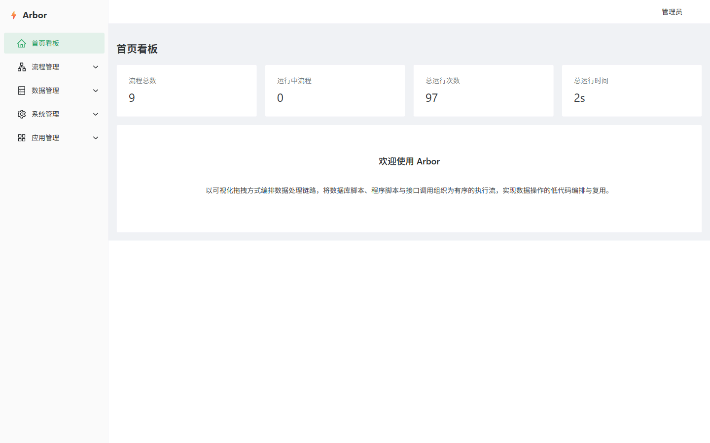

---

## 2. 快速开始

### 2.1 环境要求

- JDK 21、Maven 3.8+
- MySQL 8.x
- Redis 6+
- Node.js 22+（前端和 mock 服务）

### 2.2 初始化数据库

先创建库（如果使用别的库名，把 `arbor1` 换成你的库名，并设置 `MYSQL_DATABASE`）：

```bash
mysql -h 127.0.0.1 -u root -p -e "CREATE DATABASE IF NOT EXISTS arbor1 DEFAULT CHARACTER SET utf8mb4 COLLATE utf8mb4_0900_ai_ci;"
```

按顺序导入：

```bash
# 1) 平台表 + 基础账号/角色/菜单
mysql -h 127.0.0.1 -u root -p arbor1 < arbor-server/sql/arbor.sql

# 2) 演示业务表 + 电商订单数据（同时创建 arbor_demo）
mysql -h 127.0.0.1 -u root -p arbor1 < arbor-server/sql/demo/01_business.sql

# 3) 演示平台对象：数据源/Redis/脚本/接口/流程/应用/广场/参数/定时任务
mysql -h 127.0.0.1 -u root -p arbor1 < arbor-server/sql/demo/02_platform.sql

# 4) 演示账号/角色/菜单/权限
mysql -h 127.0.0.1 -u root -p arbor1 < arbor-server/sql/demo/03_permissions.sql
```

> 本机开发也可以用项目脚本：
> `DB_NAME=arbor1 pwsh .private/tools/run_sql.ps1 arbor-server/sql/demo/02_platform.sql`
>
> ⚠️ `01/02` 会重建演示业务表并清理平台里的业务流程数据（流程/脚本/应用/日志等），**只建议在全新的演示库执行**。基础账号 admin/test 和角色/菜单不会被删除。

### 2.3 初始化 Redis

```bash
redis-cli -h 127.0.0.1 -p 6379 -a 123456 -n 1 < demo/redis/seed.redis
```

如果你的 Redis 没有密码，去掉 `-a 123456`。

### 2.4 启动 Mock API

```bash
node demo/mock-api/server.mjs
# 可选：DEMO_MOCK_PORT=8090 node demo/mock-api/server.mjs
```

自测：

```bash
curl http://127.0.0.1:8090/api/demo/ping
curl "http://127.0.0.1:8090/api/demo/orders?status=PAID&limit=3"
```

### 2.5 启动后端

确保环境变量指向你的 MySQL/Redis：

```bash
export MYSQL_HOST=127.0.0.1
export MYSQL_PORT=3306
export MYSQL_USER=root
export MYSQL_PASSWORD=root
export MYSQL_DATABASE=arbor1
export REDIS_HOST=127.0.0.1
export REDIS_PASSWORD=123456
export REDIS_DATABASE=0

cd arbor-server
mvn spring-boot:run
```

Windows PowerShell：

```powershell
$env:MYSQL_HOST='127.0.0.1'
$env:MYSQL_PORT='3306'
$env:MYSQL_USER='root'
$env:MYSQL_PASSWORD='root'
$env:MYSQL_DATABASE='arbor1'
$env:REDIS_HOST='127.0.0.1'
$env:REDIS_PASSWORD='123456'
$env:REDIS_DATABASE='0'
cd arbor-server
mvn spring-boot:run
```

本机开发脚本（包含前端构建、复制到 static、重启）：

```powershell
pwsh .private/tools/server.ps1 restart -Ui
```

### 2.6 启动前端

开发模式：

```bash
cd arbor-ui
npm install
npm run dev
```

打开 `http://localhost:5173`。如果使用构建产物，执行 `npm run build` 后由后端静态目录提供，访问 `http://localhost:8088`。

### 2.7 登录账号

| 账号 | 密码 | 用途 |
|---|---|---|
| `admin` | `admgwl66` | 管理员，全部菜单和全部演示数据 |
| `demo` | `demo123` | 演示分析员：流程/日志/文件/审计/应用广场，可执行共享应用 |
| `test` | `test` | 普通用户，也可看到分配给自己的广场应用 |

> 根目录 README 之前写的 `admin/admin123` 是旧值，已同步修正为 `admgwl66`。

### 2.8 启动后先做一次

1. 用 admin 登录，打开“流程管理 → 执行日志”，确认能看到历史日志（种子不导入日志，日志来自你接下来的执行）。
2. 打开“应用管理 → 我的应用”，找到“订单查询”，点击“执行”。
3. 定时任务“每日统计”在种子中已启用（每 5 分钟一次），后端启动后会自动注册；演示结束请按 5.7 关闭。

---

## 3. 演示数据设计

### 3.1 业务表

| 表 | 内容 |
|---|---|
| `demo_customer` | 8 个客户（张伟、李娜、王强……） |
| `demo_product` | 8 个商品（键盘、鼠标、显示器……） |
| `demo_order` | 20 笔订单，状态 PAID / SHIPPED / COMPLETED / CANCELLED |
| `arbor_demo.demo_order` | 6 笔订单（含一笔 prod 专属），用于环境覆写演示 |

### 3.2 8 条演示流程

| 流程 | 节点 | 覆盖功能 |
|---|---|---|
| 演示01-订单查询与字段映射 | START → SQL节点 → 程序节点 → END | 应用参数表单、SQL/程序脚本、变量池、字段映射、表格/JSON/文本、整列复制 |
| 演示02-API与Redis缓存 | START → Redis GET&SET（未命中分支：接口节点）→ END | 接口调用、Redis 数据源/前缀/配置、GET&SET、分支、缓存命中/未命中 |
| 演示03-子流程订单汇总 | START → SQL节点 → 流程节点（REF_FLOW）→ END | 子流程、入参传递、子流程返回值 |
| 演示03S-订单汇总子流程 | START → SQL节点 → 程序节点 → END | 被 03 引用的子流程 |
| 演示04-Excel上传与导出 | START（文件上传 + FILE 输出）→ 程序节点 → END | 示例文件、上传、Excel 解析、输出文件下载、文件管理 |
| 演示05-异常停止 | START → 接口节点（业务错误）→ SQL节点（不执行）→ END | 异常停止（黄色）、停止提示、日志 |
| 演示06-正常停止 | START → SQL节点（空结果）→ 程序节点（不执行）→ END | 正常停止（蓝色） |
| 演示07-定时统计 | START → SQL节点 → 程序节点 → END | 定时任务、调度日志、脚本日志 |
| 演示08-内联资源与工具类 | START → 内联SQL → 内联接口 → 内联Redis → 内联程序 → END | 内联资源、工具类、全局参数、`_env`/`_env_code`、promote/demote |

> “演示03S”是子流程，不需要单独执行；从“演示03”主流程进入即可。

### 3.3 演示应用与广场

“我的应用”中有 8 个应用，均为 admin 创建；应用广场“电商数据演示广场”已共享给 `test` 和 `demo`。

- 订单查询：shared 到 dev/test/prod 三个环境
- 订单汇总：shared 到 dev/test/prod 三个环境
- 其余应用：shared 到 test 环境

---

## 4. 页面功能地图

| 菜单 | 可以体验什么 |
|---|---|
| 首页看板 | 流程/应用/执行统计、趋势图 |
| 流程管理 → 流程列表 | 搜索、排序、启停、导入/导出、进入设计器、删除 |
| 流程管理 → 执行日志 | 多条件筛选、详情、节点状态、脚本日志、停止类型 |
| 流程设计器 | 拖拽节点、START 入参/参数表单/文件/输出模式、节点属性、内联/引用、变量池、字段映射、定时任务、测试流程、概览/日志/JSON/映射/文本视图、复制、保存结果示例、全屏代码编辑器（Ctrl+滚轮缩放） |
| 数据管理 → 全局参数 | 参数定义 + 按环境配置值（`demo_greeting` 在 dev/test/prod 不同） |
| 数据管理 → 数据源配置 | MySQL/Oracle/达梦/PostgreSQL 类型、连接测试、使用情况、环境覆写 |
| 数据管理 → 数据库脚本 | 新增/编辑/执行预览（物理分页）、参数化 SQL、DML、字段顺序/大小写 |
| 数据管理 → 程序脚本 | Groovy 脚本、运行、超时、内联/引用、追踪 |
| 数据管理 → 工具类 | 全局 Groovy 工具类（`DemoStringUtil`），创建/编辑/删除，脚本内直接使用 |
| 数据管理 → 接口配置 | GET/POST/PUT/DELETE、Headers/Params/Body、超时、测试、追踪 |
| 数据管理 → Redis 数据源 | 连接测试、DB 隔离、业务前缀、使用情况 |
| 数据管理 → Redis 配置 | GET/SET/DEL/EXPIRE/TTL/EXISTS/GET&SET、完整 key 预览、测试、追踪 |
| 数据管理 → 环境管理 | dev/test/prod，默认环境，应用/参数/数据源按环境取值 |
| 数据管理 → 文件管理 | 示例文件与执行输出文件、下载、删除 |
| 系统管理 → 用户/部门/角色/菜单 | 演示用户 `demo`、部门“数据集成部”、角色“演示分析员”、文件/审计菜单 |
| 系统管理 → 操作审计 | 登录、增删改、导入导出等后台操作（只读） |
| 应用管理 → 我的应用 | 执行、参数表单、环境切换、上传文件、结果表格/JSON/文本、整列复制、共享、导出、导入 |
| 应用管理 → 应用广场 | 广场 CRUD、人员分配、进入广场执行共享应用 |

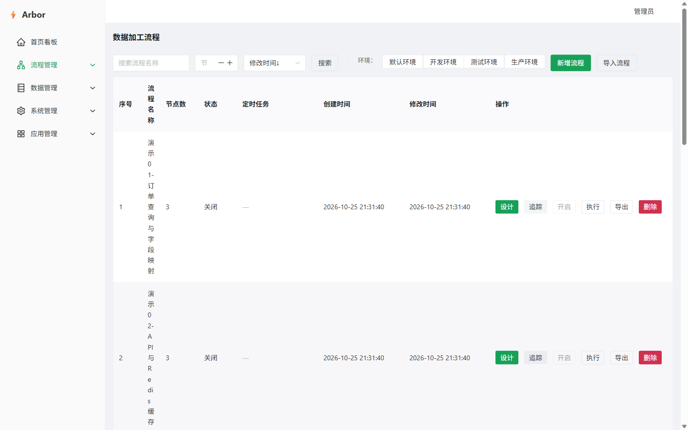
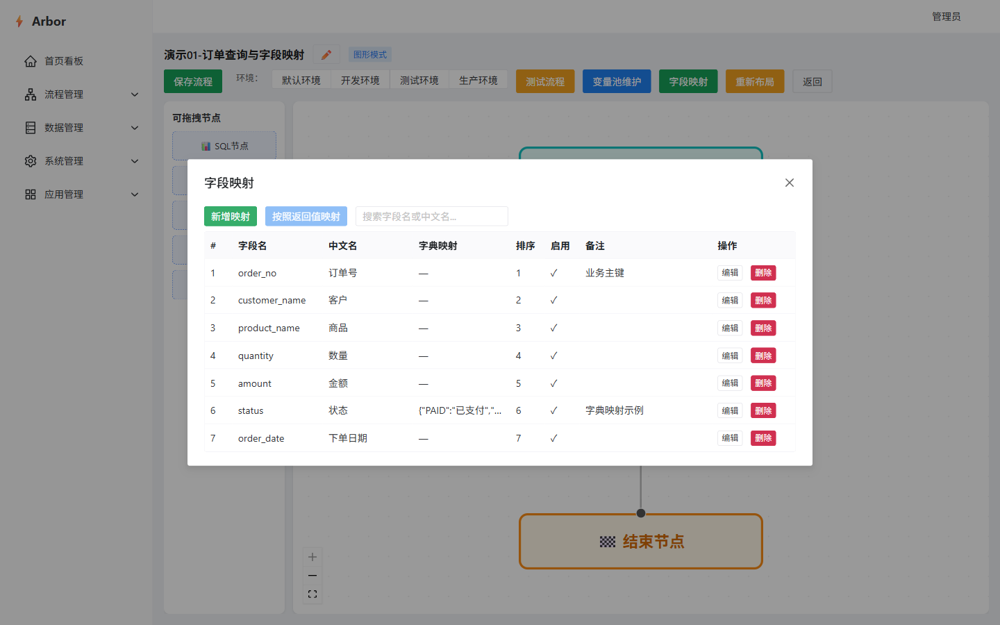
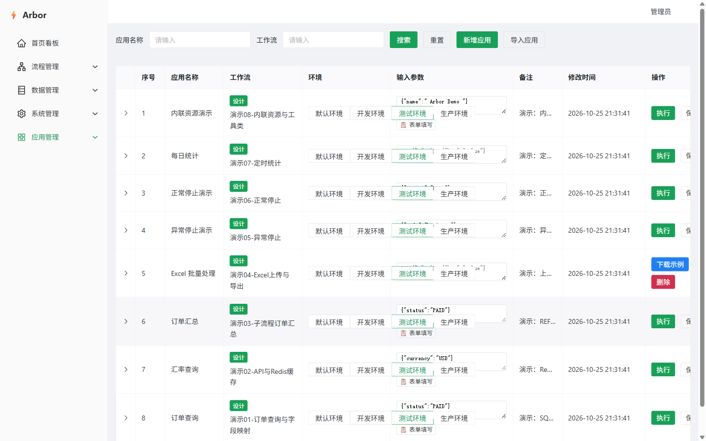

---

## 5. 按流程走一遍

### 5.1 订单查询（字段映射 / 文本 / 整列复制）

1. admin 登录 → 应用管理 → 我的应用 → “订单查询” → 执行。
2. 展开结果行，默认“表格”：列头是中文（订单号、客户、商品、数量、金额、状态、下单日期），状态 `PAID` 已按字典映射为“已支付”。
3. 每个列头右侧有 📋 角标：点击复制整列（不含表头、保留空行）。
4. 切到“文本”：显示 TSV 文本，可勾选“含表头”，右侧显示“行数 · 字符数”，点“复制”复制当前可见内容。
5. 切换到“JSON”查看原始返回；切换“表格/JSON/文本”后再次执行，视图类型会保留。
6. 环境切到“生产环境”再执行：数据源按环境覆写为 `arbor_demo`，PAID 订单只剩 3 笔，可直接对比 dev/test 的 9 笔。

截图：

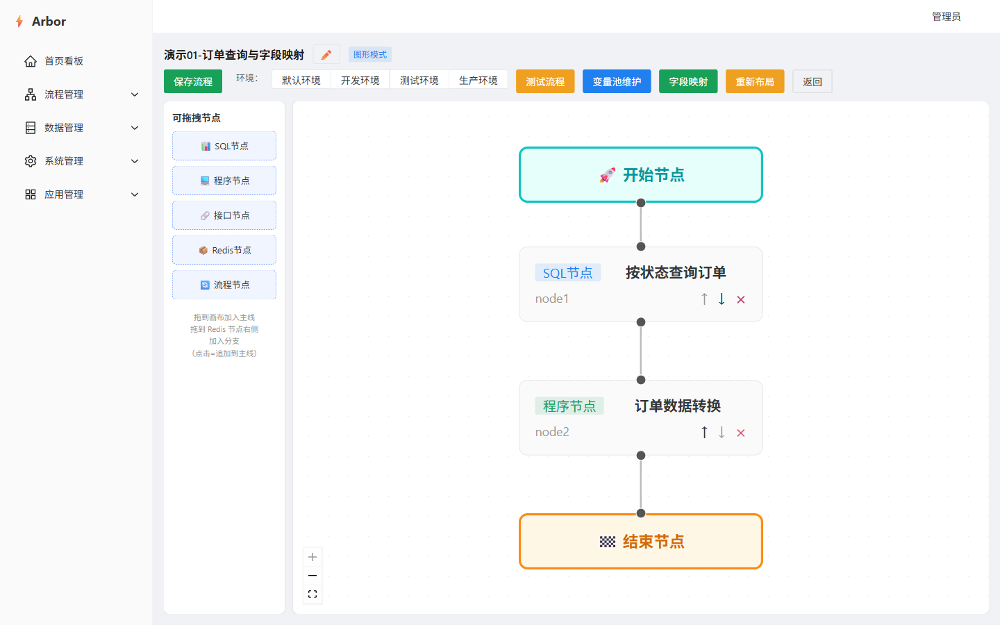
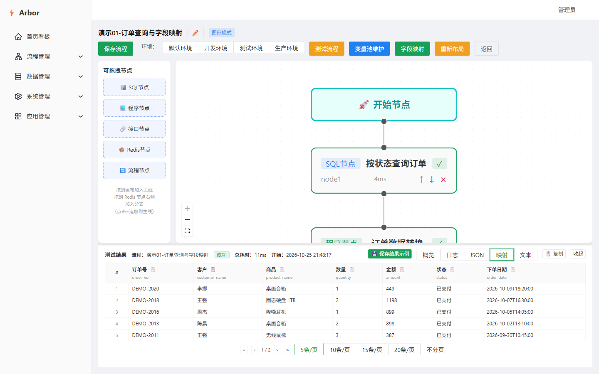
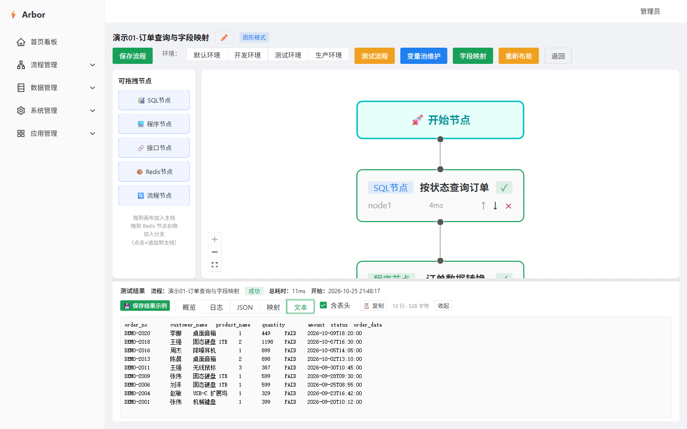

### 5.2 API + Redis 缓存（分支 / 命中）

1. 应用“汇率查询”默认 `{"currency":"USD"}`。
2. 先清掉 USD 缓存（可选）：
   `redis-cli -h 127.0.0.1 -p 6379 -a 123456 -n 1 DEL demo:exchange_rate:USD`
3. 第一次执行：Redis GET&SET 未命中 → 右侧分支“调用汇率接口” → mock 返回 USD 汇率 → 结果回填到 `demo:exchange_rate:USD`，TTL 60 秒。
4. 第二次执行：直接命中缓存，不再调用接口。
5. 打开“执行日志 → 详情”，可以看到 Redis 节点、分支接口节点的耗时与状态；服务端日志会打印“未命中/命中”。
6. 把币种改成 `EUR`：种子预置了 `demo:exchange_rate:EUR`，第一次就命中。

### 5.3 子流程汇总

1. 应用“订单汇总”执行，返回 `{count, totalAmount, byStatus}`。
2. 打开“演示03-子流程订单汇总”设计器：SQL 节点 → 流程节点（引用“演示03S-订单汇总子流程”）。
3. 子流程内部：START → SQL 节点（用 `_input.status` 查询）→ 程序节点（变量池 `orders` 汇总）。
4. 在子流程设计器里改一个节点再测试，可看到子流程的节点状态冒泡到父流程日志详情。

### 5.4 Excel 上传与导出

1. 先给“演示04-Excel上传与导出”的 START 节点上传示例文件：
   - 打开流程设计器 → 点击“开始节点” → 打开“启用文件上传”和“启用示例文件” → 选择 `demo/files/demo_orders.xlsx` → 保存流程。
2. 回到“我的应用 → Excel 批量处理”，此时操作列出现“下载示例”。
3. 点“⬆”上传 `demo/files/demo_orders.xlsx`，点“执行”。
4. 结果面板显示输出文件下载；下载后打开，最后一列“处理结果”为“已处理”。
5. 打开“文件管理”：能看到示例文件和执行输出文件；输出文件可删除。

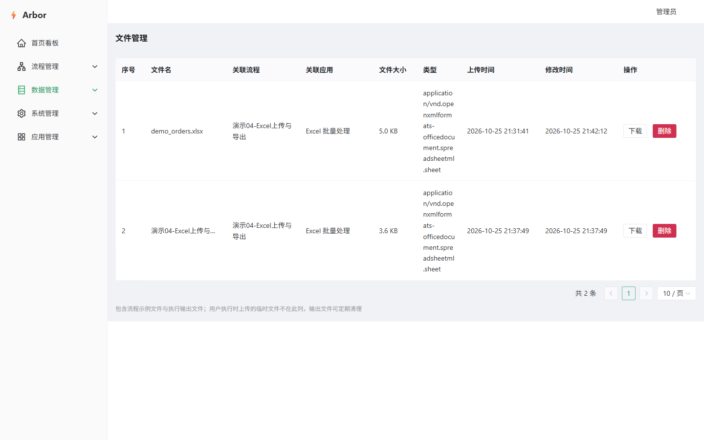

### 5.5 异常停止（黄色）与正常停止（蓝色）

**异常停止：**

1. 应用“异常停止演示”执行，输入 `{"mode":"business"}`。
2. mock 接口返回 HTTP 200 + 业务码 `5001`；接口节点本身成功，但停止条件 `data.code != 0` 命中。
3. 流程状态为 STOPPED / ABNORMAL，后续 SQL 节点不执行；日志详情显示黄色“异常停止”和停止原因。

**正常停止：**

1. 应用“正常停止演示”执行，输入 `{"status":"NOPE"}`。
2. SQL 查询结果为空，正常停止条件 `data.isEmpty()` 命中。
3. 流程状态为 STOPPED / NORMAL，后续程序节点不执行；日志详情显示蓝色“正常停止”。

### 5.6 定时统计

1. 种子中“演示07-定时统计”已启用（Cron `0 */5 * * * ?`），后端启动后自动注册。
2. 每 5 分钟执行一次，执行日志来源为“自动执行”，流程内程序脚本会打印“统计格式化…”脚本日志。
3. 打开“执行日志 → 详情”查看脚本日志；也可以在流程设计器 START 面板查看“已执行次数/上次/下次”。
4. **演示结束请关闭**：流程设计器 → START 节点 → 定时任务 → 关闭“启用调度”；或调用
   `PUT /api/flow-schedule/toggle/9?enabled=false`。

### 5.7 内联资源与工具类

1. 应用“内联资源演示”执行，输入 `{"name":" Arbor Demo "}`。
2. 结果包含：
   - `greeting`：全局参数 `demo_greeting`（test 环境为“你好，测试环境”）
   - `envId` / `envCode`：`3` / `test`
   - `upperName`：`ARBOR DEMO`（工具类 `DemoStringUtil.trimAndUpper`）
   - `maskedName`：`A*********`（工具类 `DemoStringUtil.maskName`）
   - `orderCount` / `firstOrder`：内联 SQL 查询结果
3. 打开流程设计器，选中 SQL/程序/接口/Redis 节点，可以看到“资源模式：内联/引用”切换：
   - 内联资源属于当前流程，其他流程看不到；
   - “转为全局”后出现在对应服务列表；
   - 引用全局资源后可“转为内联”复制一份。
4. 打开“数据管理 → 工具类”查看 `DemoStringUtil`；程序脚本里直接写 `DemoStringUtil.trimAndUpper(...)` 即可使用。

---

## 6. 服务页面速览

### 6.1 全局参数与环境

- `demo_greeting`：默认/开发/测试/生产四个环境值不同。
- `demo_api_base`、`demo_status_default`、`demo_tax_rate`：演示参数。
- 打开“全局参数”点参数行可编辑各环境值；在流程里用 `${global_demo_greeting}` 或变量池引用。

### 6.2 数据源与环境覆写

- “演示-MySQL-arbor1”：MySQL，连接 `arbor1`。
- 点“环境配置”给“生产环境”覆写 `database_name=arbor_demo`；其它环境走 `arbor1`。
- 连接测试、使用情况（哪些 DB 脚本引用）都可点。

### 6.3 数据库脚本

- `演示-订单明细`：无参查询，执行预览可看物理分页。
- `演示-按状态查订单`：使用 `${_input.status}`，在流程/应用里执行；在脚本页直接执行会提示缺少 `_input`。
- `演示-订单状态统计`：GROUP BY 统计，供定时流程使用。
- `演示-更新订单备注`：DML UPDATE，执行预览会返回 affectedRows。
- `演示-内联查询`：流程 08 的内联资源，不出现在全局列表（需在流程设计器里看）。

### 6.4 程序脚本与工具类

- `演示-订单转换`：使用变量池 `orderList`。
- `演示-订单汇总`：使用变量池 `orders`，兼容 `_input`。
- `演示-Excel解析`：使用 `_fileStream` 和 `excelUtil.parse`。
- `演示-统计格式化`：使用变量池 `stats`。
- `演示-内联转换`：流程 08 的内联程序，使用 `inlineRows`、`greeting`、`DemoStringUtil`。
- 工具类 `DemoStringUtil`：全局共享，脚本内直接按类名调用。

### 6.5 接口配置

- `演示-回显接口`：可在接口页直接“测试”，返回 query/headers/body。
- `演示-汇率接口`、`演示-业务失败接口`、`演示-订单接口`、`演示-统计接口`：URL/Body 使用 `${_input.xxx}`，请在流程内使用。
- `演示-慢接口`：mock 延迟 5 秒、接口超时 2 秒，可在接口页“测试”观察超时错误。
- 内联接口 `演示-内联接口`：流程 08 专属。

### 6.6 Redis 数据源 / 前缀 / 配置

- Redis 数据源：`演示-Redis-本地DB1`，DB 1，和平台缓存 DB0 隔离。
- 业务前缀：`demo`，最终 key = `demo:{redisKey}`。
- 配置覆盖 GET / SET / DEL / EXPIRE / TTL / EXISTS / GET&SET：
  - SET/GET/EXISTS/TTL/EXPIRE/DEL 可在配置页直接“测试”；
  - `演示-汇率缓存` 的 key 含 `${_input.currency}`，请在流程内执行；
  - `演示-读取内联缓存` 可在流程 08 执行后“测试”，读取 `demo:inline:last_run`。

### 6.7 用户 / 部门 / 角色 / 菜单 / 审计

- 部门“数据集成部”；用户 `demo` 属于该部门。
- 角色“演示分析员”：只有看板、流程列表、执行日志、我的应用、应用广场、文件管理、操作审计权限，可执行共享应用。
- 菜单“文件管理”“操作审计”已加入种子；可在“菜单管理”调整排序/图标/权限码。
- 操作审计页只读，记录登录、增删改、导入导出；敏感参数已脱敏。

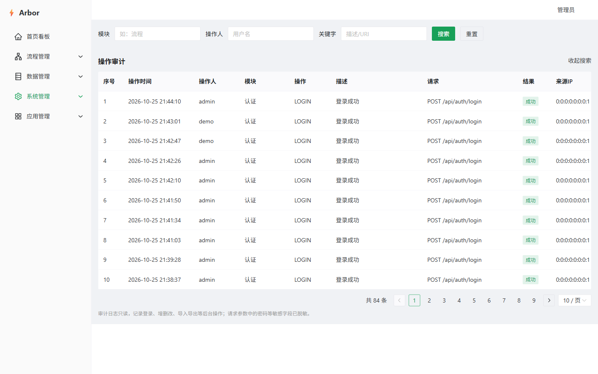

### 6.8 应用广场

- “电商数据演示广场”已包含 8 个应用；订单查询/订单汇总共享了 dev/test/prod 三个环境。
- 管理员可在广场列表点“人员”，把广场分配给 `demo`/`test`。
- 用 demo 登录后，侧边栏只有有限菜单；进入应用广场可执行共享应用。
- 应用共享按“应用 + 环境”生效；广场里可以看到每个应用可用的环境。

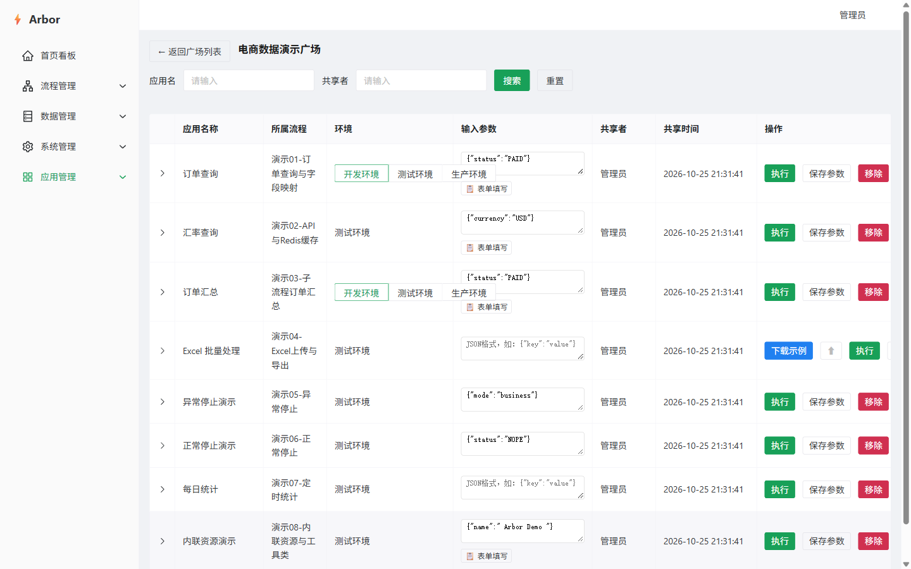

---

## 7. 导入 / 导出 / 追踪

- **导出流程**：流程列表 → 某行“导出”，下载 `arbor-package` JSON。
- **导入流程**：流程列表 → “导入流程” → 选择 JSON → 预览冲突/缺失参数 → 选择跳过或覆盖 → 执行。
- **导出/导入应用**：我的应用 → 某行“导出”；“导入应用”同理。
- **引用追踪**：DB 脚本/程序脚本/接口/Redis 配置列表的“追踪”按钮，打开引用关系抽屉（DAG）。
- **使用情况**：数据源/Redis 数据源的“使用情况”，查看被哪些脚本/节点引用。

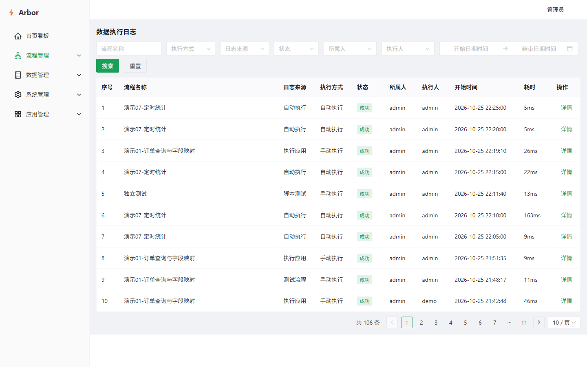

---

## 8. 种子脚本说明

| 文件 | 作用 |
|---|---|
| `arbor-server/sql/arbor.sql` | 平台基础表 + admin/test + 角色/菜单/权限 + 4 个环境 |
| `arbor-server/sql/demo/01_business.sql` | 创建 `arbor1`/`arbor_demo` 的 `demo_*` 表并写入订单数据 |
| `arbor-server/sql/demo/02_platform.sql` | 清理业务流程数据，写入演示数据源/Redis/脚本/接口/流程/应用/广场/参数/定时任务 |
| `arbor-server/sql/demo/03_permissions.sql` | 写入演示账号/角色/部门/菜单/权限/广场人员 |
| `demo/redis/seed.redis` | 演示 Redis DB1 初始 key |
| `demo/mock-api/server.mjs` | 零依赖 mock 接口 |
| `demo/files/demo_orders.xlsx` | Excel 上传示例 |
| `demo/screenshots/*.png` | 页面截图 |

> `02_platform.sql` 里的数据源密码是 AES 密文，使用 `application.yml` 默认 `aes.secret-key` 加密。如果你覆盖了 `AES_SECRET_KEY`，导入后需要在页面重新创建数据源/Redis 数据源并填写密码。

---

## 9. 常见问题

### 9.1 页面登录失败/一直跳登录

- 确认后端用的是 `arbor1`，且 Redis 平台库可连。
- 确认 `MYSQL_HOST/MYSQL_PORT/MYSQL_USER/MYSQL_PASSWORD/MYSQL_DATABASE` 和 `REDIS_HOST/REDIS_PASSWORD` 已设置。
- 切换数据库后建议清理平台 Redis 缓存：
  `redis-cli -h 127.0.0.1 -p 6379 -a 123456 -n 0 FLUSHDB`
  （会清掉登录 token 和缓存，重新登录即可；不要动 DB1 的演示数据。）

### 9.2 接口节点报“flow_param 未设置”

- 说明接口 URL/Body 里用了 `${_input.xxx}`，但没有在流程/应用的开始节点配置入参。
- 在应用“输入参数”或 START `_input` 里补上，例如 `{"currency":"USD"}`。
- 接口配置页直接“测试”时没有流程上下文，带 `${_input}` 的接口请在流程内测试。

### 9.3 Redis 节点报“全局参数不存在: _input.currency”

- 原因同上：Redis key 里有 `${_input.xxx}`，但当前执行没有 START 入参。
- 在应用/流程里补参数；配置页直接测试只适合无 `${_input}` 的 key。

### 9.4 定时任务没有执行

- 确认流程状态为“启用”（流程列表右侧开关），`flow_schedule.enabled=1`。
- 种子导入后需要重启后端，`ScheduleBootstrapper` 才会注册任务。
- 查看日志文件是否有“注册定时任务/定时任务触发”；如果提示“流程已关闭”，启用流程即可。
- 演示结束记得关闭，避免持续产生日志。

### 9.5 文件下载/上传失败

- 默认文件目录：`arbor-server/data/arbor/files`（示例/上传）和 `arbor-server/data/arbor/output`（输出）。
- 可用 `ARBOR_FILE_STORAGE_PATH`、`ARBOR_FILE_OUTPUT_PATH` 覆盖。
- 目录由服务启动时自动创建，确保进程有写权限。

### 9.6 Mock 接口连不上

- 确认 `node demo/mock-api/server.mjs` 正在运行，端口 8090 未被占用。
- 接口节点由后端发起请求，目标地址必须是后端能访问的 `127.0.0.1:8090`，不是浏览器所在机器（同机演示时一致）。
- 如果改了端口，记得同步修改接口配置里的 URL。

### 9.7 生产环境数据不对

- 这是“数据源环境覆写”的演示：数据源“演示-MySQL-arbor1”在 prod 环境覆写为 `arbor_demo`。
- 检查“数据源配置 → 环境配置 → 生产环境”的数据库名；不需要时删除该覆写即可回到 `arbor1`。

---

## 10. 重置演示

```bash
# 完全重置平台 + 演示数据（会清掉已有流程/日志/应用）
mysql -h 127.0.0.1 -u root -p arbor1 < arbor-server/sql/arbor.sql
mysql -h 127.0.0.1 -u root -p arbor1 < arbor-server/sql/demo/01_business.sql
mysql -h 127.0.0.1 -u root -p arbor1 < arbor-server/sql/demo/02_platform.sql
mysql -h 127.0.0.1 -u root -p arbor1 < arbor-server/sql/demo/03_permissions.sql
redis-cli -h 127.0.0.1 -p 6379 -a 123456 -n 1 < demo/redis/seed.redis
```

然后重启后端，让定时任务重新注册。
